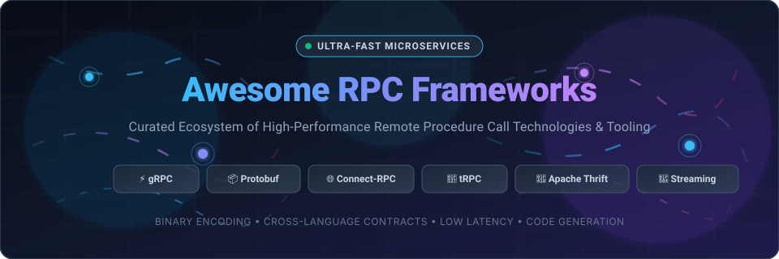

# ⚡ Awesome RPC Frameworks

**A curated, production-grade index of high-performance Remote Procedure Call (RPC) frameworks, binary serialization protocols, service meshes, and developer tooling for polyglot distributed systems.**

  
  
  
  
  
  
  

---

## 📑 Table of Contents

- [🌐 Sector Overview & Market Dynamics](#-sector-overview--market-dynamics)
- [☁️ SaaS & Hosted Platforms](#️-saas--hosted-platforms)
- [🛠️ Open-Source GitHub Projects](#️-open-source-github-projects)
- [📊 Architectural Comparison Matrix](#-architectural-comparison-matrix)
- [❓ Frequently Asked Questions (FAQ)](#-frequently-asked-questions-faq)
- [🤝 How to Contribute](#-how-to-contribute)
- [💖 Support & Sponsor](#-support--sponsor)
- [⭐ Star History](#-star-history)
- [⚖️ Disclaimer & License](#️-disclaimer--license)

---

## 🌐 Sector Overview & Market Dynamics

The global **Remote Procedure Call (RPC), API Infrastructure, and Service Mesh market** is estimated at **$6.8 billion in 2026** and is projected to expand to **$18.4 billion by 2032**, demonstrating an impressive compound annual growth rate (**CAGR of ~18.2%**). This accelerating demand is driven by the industry-wide mandate for polyglot microservice architectures, low-latency inter-service communication in real-time streaming, edge data ingress, and ultra-high-throughput token streaming across distributed Generative AI model clusters.

**Market Dynamics & Fragmentation:** The sector reflects a **moderately fragmented yet bifurcated dynamic**. At the **core foundational layer**, the market is heavily consolidated: **gRPC** and **Protocol Buffers (Protobuf)** hold an overwhelming, near-monopolistic share for inter-service communication within enterprise distributed backends. In contrast, the **supporting application and edge tier**—comprising schema registries, browser-to-backend gateways (Connect-RPC, gRPC-Web), API proxies, developer inspection tooling, and service governance platforms—remains **actively fragmented** across cloud hyperscalers (Google Cloud, AWS), content delivery edge networks (Cloudflare), and developer-first infrastructure challengers (Buf, Postman, Kong, and Apidog).

---

## ☁️ SaaS & Hosted Platforms

A curated comparison of managed cloud platforms, serverless gateways, and developer tools supporting RPC and gRPC protocols, sorted in descending order by **Company Size (Market Capitalization / Corporate Valuation & Revenue)**.

| Product & Platform | Description & Key Capabilities | Company Size (Valuation / Revenue) | Starting Tier Pricing | Free Tier Limit |
| :--- | :--- | :--- | :--- | :--- |
| **[Google Cloud Endpoints](https://cloud.google.com/endpoints)** | Enterprise-grade managed API gateway and proxy for gRPC and RESTful services deployed on Google Cloud (GKE, Cloud Run, Compute Engine) featuring integrated IAM auth, ESPv2, telemetry, and automated rate limiting. | **~$2.1T Market Cap** / ~$350B Revenue (Alphabet Inc.) | **$3.00** per million API calls (after the initial monthly free call quota) | **2,000,000 calls/month free forever**; plus $300 credit 90-day trial for all new GCP customer accounts |
| **[AWS App Mesh & ECS Service Connect](https://aws.amazon.com/app-mesh/)** | Managed Envoy-powered service mesh and native ECS service-to-service connectivity providing gRPC traffic routing, TLS encryption, circuit breaking, and AWS CloudWatch / X-Ray observability. | **~$1.9T Market Cap** / ~$575B Revenue (Amazon.com, Inc.) | **$0.00** management fee (underlying ECS compute starts at **$0.04048**/vCPU/hr; outbound data transfer starts at **$0.09**/GB) | **12-month AWS Free Tier** (750 hrs/month EC2 micro + 15 GB/month egress); Service Connect management is **$0/mo free forever** |
| **[Cloudflare gRPC](https://www.cloudflare.com/)** | Global edge network termination, multiplexed load balancing, unmetered DDoS mitigation, and HTTP/2 proxying for gRPC and gRPC-Web without maintaining custom reverse proxies. | **~$32B Market Cap** / ~$1.4B Revenue (Cloudflare, Inc.) | **$20.00/month** (Pro plan) or **$5.00/month** (Workers Paid tier with 10M requests included) | **Free forever plan** with unmetered DDoS protection, native gRPC proxying, and **100,000 Worker requests/day** |
| **[Postman](https://www.postman.com/)** | Industry-standard collaborative API client platform offering native gRPC testing, Protobuf schema reflection, client/server streaming inspection, and automated mock servers. | **~$5.6B Valuation** / ~$150M ARR (Postman, Inc.) | **$14.00/user/month** (Basic plan, billed annually) or **$19.00/user/month** (monthly billing) | **Free forever plan** for up to 3 team members, unlimited local/public workspaces, and full gRPC invocation support |
| **[Kong Konnect](https://konghq.com/products/kong-konnect)** | Cloud-native API management and service connectivity platform with first-class gRPC proxying, gRPC-Web transcoding, zero-trust mTLS security, and traffic governance. | **~$2.0B Valuation** / ~$120M ARR (Kong Inc.) | **$250.00/month** (Konnect Plus base tier, or **$0.04** per runtime instance hour) | **Free forever tier** with 1 control plane, 1 runtime group, and up to 5 services; or 30-day enterprise trial |
| **[Buf Schema Registry (BSR)](https://buf.build/)** | Dedicated developer cloud platform for Protobuf, gRPC, and Connect-RPC with schema registry, automated breaking change detection, linting, and auto-generated multi-language SDKs. | **~$500M Valuation** / ~$25M ARR (Buf Technologies, Inc.) | **$20.00/user/month** (Team plan, billed annually) | **Free forever tier** for individuals & open-source projects with unlimited public schema repositories and client generation |
| **[Apidog](https://apidog.com/)** | Integrated all-in-one API development workspace featuring unary and bidirectional gRPC invocation, proto parsing, automated schema mock servers, and CI/CD test pipelines. | **~$150M Valuation** / ~$15M ARR (Apidog Inc.) | **$9.00/user/month** (Basic plan, billed annually) or **$12.00/user/month** (monthly billing) | **Free forever plan** for up to 4 users with unlimited API calls, local mock server instances, and full gRPC debugging |

---

## 🛠️ Open-Source GitHub Projects

Explore the leading open-source RPC frameworks, schema definition languages, and performance tooling, sorted in strict descending order by **GitHub_Stars**.

### 1. 📦 [Protocol Buffers (Protobuf)](https://github.com/protocolbuffers/protobuf) 
- **License**: BSD-3-Clause | **Primary Languages**: C++, Java, Python, Go, C#, Objective-C, Ruby
- **Description**: Google's language-neutral, platform-neutral, extensible mechanism for serializing structured data. Protobuf acts as the de facto Interface Definition Language (IDL) and wire format for gRPC and modern distributed systems, producing payloads that are **3x to 10x smaller and 20x to 100x faster** than XML and JSON.
- **Key Features**: Strongly-typed schema definition (.proto), backwards/forwards schema compatibility rules, official code generators for all major programming languages, zero memory allocations on hot paths.
- **Best For**: Foundational schema definition across polyglot microservices and cross-platform distributed systems.

### 2. ⚡ [gRPC](https://github.com/grpc/grpc) 
- **License**: Apache-2.0 | **Primary Languages**: C++, Python, Ruby, PHP, C#, Objective-C, Dart
- **Description**: The industry-standard high-performance RPC framework originating from Google and hosted by the Cloud Native Computing Foundation (CNCF). Engineered on top of HTTP/2 and Protocol Buffers, gRPC enables efficient unary and streaming communication across polyglot microservice architectures.
- **Key Features**: Four execution patterns (Unary, Client-streaming, Server-streaming, and Bidirectional-streaming), binary framing over HTTP/2, pluggable authentication (mTLS, JWT, OAuth2), native load balancing, distributed tracing interceptors.
- **Best For**: High-frequency inter-service microservice backends where low latency, payload compression, and bidirectional streaming are essential.

### 3. 🌐 [Apache Dubbo](https://github.com/apache/dubbo) 
- **License**: Apache-2.0 | **Primary Languages**: Java, Go, Rust, Node.js
- **Description**: A battle-tested RPC and microservices governance framework originally developed by Alibaba and graduated to the Apache Software Foundation. Powers massive e-commerce and financial workloads handling tens of billions of daily requests.
- **Key Features**: Triple protocol (fully gRPC- and HTTP/3-compatible), dynamic service registration and discovery (Nacos, Zookeeper, Consul), multi-level traffic routing, automated load balancing, adaptive concurrency limiting.
- **Best For**: Enterprise-scale Java and Go distributed architectures requiring built-in service governance and resilience.

### 4. 🔷 [tRPC](https://github.com/trpc/trpc) 
- **License**: MIT | **Primary Languages**: TypeScript, JavaScript
- **Description**: The trailblazing TypeScript-native RPC framework that delivers end-to-end type safety between client and server without code generation, compile steps, or schema files.
- **Key Features**: Direct TypeScript inference of server router types into client query calls, compile-time detection of breaking API changes, first-class React Query and TanStack Query adapters, deep integration with Next.js, Nuxt, and SvelteKit.
- **Best For**: Full-stack TypeScript and JavaScript applications, modern monorepos, and teams demanding rapid developer velocity without IDL overhead.

### 5. 🚀 [go-zero](https://github.com/zeromicro/go-zero) 
- **License**: MIT | **Primary Languages**: Go
- **Description**: A comprehensive web and RPC microservices framework built for high concurrency and resilience under extreme traffic surges. Includes the versatile `goctl` CLI tool for automatic scaffolding and code generation.
- **Key Features**: Built-in RPC engine compatible with gRPC, adaptive rate limiting, automated circuit breaking, load-shedding mechanisms, distributed tracing, and automated database CRUD generation.
- **Best For**: High-concurrency Go microservices platforms requiring battle-tested reliability and built-in protection against cascading outages.

### 6. 🐹 [gRPC-Go](https://github.com/grpc/grpc-go) 
- **License**: Apache-2.0 | **Primary Languages**: Go
- **Description**: The official, pure-Go implementation of gRPC maintained by Google and the gRPC team. Designed to maximize Go's lightweight goroutines and network channel primitives for blistering networking throughput.
- **Key Features**: Pure Go runtime without CGo overhead, seamless integration with Go's `context.Context` package, customizable resolver and balancer interfaces, interceptor chaining, and HTTP/2 connection multiplexing.
- **Best For**: Cloud-native Go backend services, Kubernetes controllers, and distributed microservices infrastructure.

### 7. 🌉 [gRPC-Gateway](https://github.com/grpc-ecosystem/grpc-gateway) 
- **License**: BSD-3-Clause | **Primary Languages**: Go
- **Description**: A protoc compiler plugin that generates a reverse-proxy server translating RESTful JSON API requests into high-performance gRPC calls based on custom annotations in your `.proto` service definitions.
- **Key Features**: Automatic generation of OpenAPI (Swagger) v2/v3 specifications, simultaneous support for standard REST consumers and internal gRPC clients, custom HTTP response header mappings.
- **Best For**: Teams needing to expose conventional REST/JSON APIs to third-party web consumers while keeping internal service-to-service communication purely gRPC.

### 8. 🏎️ [Apache bRPC](https://github.com/apache/brpc) 
- **License**: Apache-2.0 | **Primary Languages**: C++
- **Description**: An industrial-strength C++ RPC framework developed by Baidu and hosted by Apache. Extensively deployed across latency-critical search engines, recommendation engines, autonomous driving pipelines, and ad tech clusters.
- **Key Features**: Asynchronous I/O driven by user-space threading (`bthread`), sub-millisecond latencies, built-in diagnostic and profiling web servers on every node, support for Baidu-std, gRPC, and HTTP protocols.
- **Best For**: Extreme performance-critical C++ services, real-time machine learning inference, and low-latency financial systems.

### 9. 🛡️ [Cap'n Proto](https://github.com/capnproto/capnproto) 
- **License**: MIT | **Primary Languages**: C++, Rust, Go, Python, JavaScript
- **Description**: An extraordinarily fast data interchange format and capability-based RPC system created by Kenton Varda (former author of Protobuf v2). Operates with **zero encoding/decoding overhead** because the in-memory data layout is identical to the wire format.
- **Key Features**: Zero serialization/deserialization CPU cost, capability-based security model, time-travel promise pipelining that allows clients to call methods on the results of pending RPCs without waiting for intermediate network round-trips.
- **Best For**: High-throughput IPC, kernel-to-user-space messaging, distributed storage, and applications where CPU serialization overhead is a primary bottleneck.

### 10. 💻 [grpcurl](https://github.com/fullstorydev/grpcurl) 
- **License**: MIT | **Primary Languages**: Go
- **Description**: The ubiquitous command-line tool that brings the simplicity of `curl` to gRPC servers. Communicates directly with gRPC endpoints using server reflection or local `.proto` files.
- **Key Features**: Dynamic service discovery via gRPC reflection, invocation of unary and streaming methods via JSON input, support for plaintext and TLS/mTLS authentication, easily scriptable in CI/CD pipelines.
- **Best For**: Debugging, manual testing, ad-hoc RPC inspection, and automated health checking in terminal environments.

### 11. 🦀 [Tonic](https://github.com/hyperium/tonic) 
- **License**: MIT | **Primary Languages**: Rust
- **Description**: A native, production-grade gRPC client and server framework for Rust, built directly upon Tokio, Tower, and Hyper. Delivers uncompromising memory safety paired with blazing async networking.
- **Key Features**: Ergonomic async/await syntax, bi-directional streaming support, composable middleware layers via Tower services, custom TLS configuration, high-performance Prost-based code generation.
- **Best For**: Memory-safe, high-concurrency systems programming, infrastructure daemons, and microservices written in Rust.

### 12. 🐘 [Apache Thrift](https://github.com/apache/thrift) 
- **License**: Apache-2.0 | **Primary Languages**: C++, Java, Python, Go, C#, Erlang, Haskell, Ruby
- **Description**: The classic cross-language service development framework originally developed by Facebook. Provides a comprehensive code generation engine and runtime library spanning more than 25 programming languages.
- **Key Features**: Strict separation of transport abstraction (TCP, HTTP, memory buffer), serialization protocol (Binary, Compact, JSON), and server models (Simple, Threaded, Non-blocking).
- **Best For**: Legacy enterprise systems, large multi-language corporate environments, and data pipelines integrated with Apache Hadoop and Dataproc.

### 13. 🐦 [Finagle](https://github.com/twitter/finagle) 
- **License**: Apache-2.0 | **Primary Languages**: Scala, Java
- **Description**: Twitter's battle-hardened, protocol-agnostic RPC system for the JVM. Models remote calls as asynchronous mathematical functions (`Service[Req, Rep]`) using composable `Future` abstractions.
- **Key Features**: Protocol-agnostic core (Thrift, HTTP, Mux), intelligent client-side load balancing (d-left power-of-two-choices), failure accrual circuit breakers, distributed tracing (Zipkin integration).
- **Best For**: JVM-based microservices, high-traffic distributed services, and Scala backends requiring robust connection pooling and fault tolerance.

### 14. ⚡ [rpcx](https://github.com/smallnest/rpcx) 
- **License**: Apache-2.0 | **Primary Languages**: Go
- **Description**: A zero-configuration, ultra-fast Go RPC framework designed as a performant, lightweight alternative to gRPC and Dubbo for Go developers.
- **Key Features**: Support for diverse serialization codecs (Protobuf, MessagePack, JSON, Msgpack), multi-registry service discovery (Etcd, Consul, Zookeeper, Redis), point-to-point and broadcast routing, traffic throttling.
- **Best For**: Rapid Go microservice development with flexible serialization choices and minimal boilerplate.

### 15. 🪁 [Kitex](https://github.com/cloudwego/kitex) 
- **License**: Apache-2.0 | **Primary Languages**: Go
- **Description**: ByteDance's flagship high-throughput Go RPC framework developed for extreme concurrency. Replaces standard Go `net` packages with custom `Netpoll` reactive I/O multiplexing.
- **Key Features**: Dual Protobuf and Thrift support, fast zero-copy memory buffers, proxyless service mesh integration, built-in governance (circuit breaking, adaptive rate limiting, tracing).
- **Best For**: Go backends operating at hyper-scale concurrency where memory allocation and network latency are critical bottlenecks.

### 16. 🟣 [Twirp](https://github.com/twitchtv/twirp) 
- **License**: Apache-2.0 | **Primary Languages**: Go, Python, TypeScript, PHP
- **Description**: Twitch's straightforward, pragmatic RPC framework based on Protocol Buffers. Deliberately runs over standard HTTP 1.1 and HTTP/2 without the complex HTTP/2 framing and trailer requirements of gRPC.
- **Key Features**: Automatic generation of Go client and server routing, dual JSON and binary Protobuf support on every route, standard HTTP status codes, simple debugging via standard curl commands.
- **Best For**: Pragmatic Go engineering teams that want Protobuf type safety and schema contracts without gRPC's operational and proxy overhead.

### 17. 🧅 [MagicOnion](https://github.com/Cysharp/MagicOnion) 
- **License**: MIT | **Primary Languages**: C#
- **Description**: A unified modern RPC and real-time network engine for .NET and Unity. Treats C# interfaces as API contracts, eliminating external `.proto` files and build-time code generation.
- **Key Features**: Powered by gRPC and MessagePack serialization, bidirectional streaming hubs for real-time multiplayer gaming, shared data models between Unity client and .NET backend.
- **Best For**: Unity game development, real-time interactive apps, and full-stack C# .NET microservices.

### 18. 🔌 [Connect-RPC](https://github.com/connectrpc/connect-go) 
- **License**: Apache-2.0 | **Primary Languages**: Go, TypeScript/JavaScript, Swift, Kotlin
- **Description**: The modern, multi-protocol RPC framework engineered by Buf. A single Connect server simultaneously speaks the standard gRPC protocol, gRPC-Web for browsers, and the HTTP-native Connect protocol.
- **Key Features**: Eliminates Envoy proxy requirements for web clients, full browser compatibility via standard fetch APIs, HTTP GET queries with CDN caching support, idiomatic and clean code generation.
- **Best For**: Teams bridging browser frontend clients directly to gRPC backend microservices without proxy infrastructure.

### 19. 🎯 [tarpc](https://github.com/google/tarpc) 
- **License**: MIT | **Primary Languages**: Rust
- **Description**: An ergonomic asynchronous RPC framework for Rust created by Google engineers. Allows developers to define services directly within native Rust syntax using procedural macros.
- **Key Features**: No external IDL or proto compiler required, native Serde serialization across any transport stream (TCP, Unix sockets), transparent request tracing via the `tracing` ecosystem.
- **Best For**: Pure Rust projects and distributed daemons seeking idiomatic async RPC with zero external build dependencies.

### 20. 🏎️ [Volo](https://github.com/cloudwego/volo) 
- **License**: Apache-2.0 / MIT | **Primary Languages**: Rust
- **Description**: ByteDance's ultra-high-performance, extensible Rust microservices framework. Optimized for maximum throughput and microscopic tail latencies in distributed cloud architectures.
- **Key Features**: Full Thrift and gRPC support, sonic-rs ultra-fast serialization, custom memory allocators, highly modular middleware abstraction for traffic management and telemetry.
- **Best For**: High-throughput Rust microservices in high-density distributed systems where performance and hardware efficiency are top priorities.

---

## 📊 Architectural Comparison Matrix

| Framework | Primary Language(s) | Default Serialization | Transport Protocol | Streaming Capability | Schema Requirement | Best Fit / Primary Use Case |
| :--- | :--- | :--- | :--- | :--- | :--- | :--- |
| **gRPC** | Polyglot (10+ langs) | Protocol Buffers | HTTP/2 | Bidirectional, Client, Server | Yes (`.proto`) | Polyglot enterprise microservices |
| **tRPC** | TypeScript | JSON / SuperJSON | HTTP 1.1 / HTTP/2 | Subscription / SSE | No (Inferred TS Types) | Full-stack TypeScript & Next.js apps |
| **Connect-RPC** | Go, TS, Swift, Kotlin | Protobuf or JSON | HTTP 1.1 / HTTP/2 | Bidirectional, Client, Server | Yes (`.proto`) | Browser-to-backend without Envoy |
| **Apache Dubbo** | Java, Go | Triple / Protobuf / Hessian | HTTP/2 / TCP / HTTP/3 | Bidirectional Streaming | Optional / Code-first | Enterprise Java/Go service governance |
| **go-zero** | Go | Protobuf | HTTP/2 | Unary & Streaming | Yes (`.proto`) | High-traffic Go microservices |
| **Cap'n Proto** | C++, Rust, Go, Python | Cap'n Proto (Zero-copy) | TCP / IPC / Pipelined | Promise Pipelining | Yes (`.capnp`) | Zero-copy IPC & ultra-low CPU overhead |
| **Apache Thrift** | Polyglot (25+ langs) | Thrift Binary / Compact | Raw TCP / Framed / HTTP | Unary & Asynchronous | Yes (`.thrift`) | Legacy multi-language platforms |
| **Twirp** | Go, Python, TS | Protobuf or JSON | HTTP 1.1 / HTTP/2 | Unary | Yes (`.proto`) | Simpler Go RPC without HTTP/2 framing |
| **Tonic** | Rust | Protocol Buffers | HTTP/2 | Bidirectional, Client, Server | Yes (`.proto`) | Async, memory-safe Rust services |
| **MagicOnion** | C# | MessagePack | HTTP/2 (gRPC) | Bidirectional Hubs | No (C# Interfaces) | Unity multiplayer games & .NET backends |

---

## ❓ Frequently Asked Questions (FAQ)

### 1. What are the key performance benefits of RPC over traditional REST?
RPC frameworks utilize compact binary serialization protocols (such as **Protocol Buffers** or **Cap'n Proto**) that generate payloads **50% to 80% smaller** than traditional text-based JSON. Furthermore, modern RPC frameworks utilize **HTTP/2 multiplexing**, eliminating the HTTP/1.1 head-of-line blocking problem and slashing TCP handshake overhead by executing concurrent requests over a single persistent connection.

### 2. Why does gRPC require proxies like Envoy or Connect-RPC for browser clients?
Standard web browsers do not expose low-level APIs to control HTTP/2 framing or inspect HTTP/2 trailing headers (trailers). Because gRPC relies on trailers to deliver call status codes (`grpc-status`), browsers cannot communicate with native gRPC servers directly. Solutions like **Connect-RPC** resolve this by introducing an HTTP-native protocol that operates seamlessly in browsers via standard `fetch()` without requiring external translation proxies.

### 3. When should I choose tRPC over gRPC?
Choose **tRPC** if your entire application stack is built on **TypeScript** (e.g., Next.js, Remix, Astro, or Express). tRPC provides instant end-to-end type safety with zero code generation or compilation steps. Choose **gRPC** or **Connect-RPC** when your architecture is polyglot (e.g., Go, Python, Rust, Java) or when you require binary compression, strict cross-language contracts, or mobile client integration.

---

## 🤝 How to Contribute

Contributions are welcome! If you know of an outstanding open-source RPC framework, serialization protocol, or hosted developer platform:

1. 🍴 **Fork** this repository.
2. 🌿 Create a descriptive feature branch (`git checkout -b feature/add-new-rpc-framework`).
3. 📝 Add your entry with factual descriptions, active links, and correct category placement.
4. 📬 Submit a Pull Request with a clear summary of the additions.

---

## 💖 Support & Sponsor

If this curated RPC repository has accelerated your architecture decisions, saved your engineering team time, or helped streamline your microservices stack, please consider supporting the project:

- ⭐ **Star this repository** to help other engineers discover it.
- 🍴 **Fork and share** with your platform and backend development teams.
- ☕ **Buy a coffee & sponsor ongoing maintenance** via the **[GitHub Sponsors Dashboard](https://github.com/sponsors/ishandutta2007)**.

Your sponsorship directly funds ongoing curation, benchmark updates, and open-source tooling!

---

## ⭐ Star History

---

## ⚖️ Disclaimer & License

- This repository is a community-curated directory intended for educational and architectural reference. Product names, logos, and brands are property of their respective owners.
- Distributed under the [MIT License](LICENSE).
